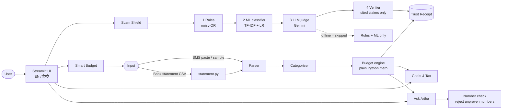

# Artha Kavach — Architecture

## High-level flow

```
┌─────────────────────────────────────────────────────────────────────┐
│                        Streamlit UI (app/)                          │
│                                                                     │
│  ┌──────────────┐  ┌──────────────────┐  ┌──────────────────────┐  │
│  │ Scam Shield  │  │   Smart Budget   │  │  About / How it Works│  │
│  │  (scam_ui)   │  │  (budget_ui)     │  │    (about_ui)        │  │
│  └──────┬───────┘  └────────┬─────────┘  └──────────────────────┘  │
│         │                   │                                       │
└─────────┼───────────────────┼───────────────────────────────────────┘
          │                   │
          ▼                   ▼
┌─────────────────┐  ┌─────────────────────────────────────────────┐
│  scam/pipeline  │  │                  core/                       │
│                 │  │                                              │
│  ① rules.py     │  │  parser.py     → ParsedTransaction          │
│     RulesResult │  │  categoriser.py→ CategorisedTransaction     │
│                 │  │  budget_engine → BudgetSummary              │
│  ② classifier  │  │  nudges.py     → list[NudgeDict]            │
│     TF-IDF+LR   │  │  savings.py    → SavingsPlan                │
│                 │  └──────────────────────────────────────────────┘
│  ③ llm_judge   │
│     ScamVerdict │
│                 │       Both modules
│  ④ verifier    │──────────────────▶  core/trust_receipt.py
│     ClaimVerify │                         TrustReceipt
│                 │
│  ⑤ TrustReceipt│
└─────────────────┘

Both pipelines call:
  llm/adapter.py    ← Gemini API (retry, cache, structured JSON output)
  llm/prompts.py    ← Versioned prompt constants
  llm/schemas.py    ← Pydantic output validation

Scam pipeline also calls:
  rag/retrieve.py   ← Semantic search over FAISS index
  rag/ingest.py     ← One-time index build from data/kb/
```

---

## Scam Shield — step-by-step

```
Input SMS
   │
   ├─► 1. rules.py ──────────────────────────────────────────────────┐
   │      10+ regex/keyword patterns                                  │
   │      Noisy-OR score: s = 1 - ∏(1 - wᵢ) over matched rules      │
   │      → RulesResult(score, matches[])                             │
   │                                                                  │
   ├─► 2. classifier.py ──────────────────────────────────────────────┤
   │      TF-IDF: word 1-2 grams + char_wb 2-5 grams (FeatureUnion)   │
   │      Logistic Regression C=1, max_iter=1000                      │
   │      Trained on 108 messages (70% of scam_eval.csv, seed=42)     │
   │      → {scam: p₁, suspicious: p₂, safe: p₃}                     │
   │                                                                  │
   ├─► 3. rag/retrieve.py (if retriever available) ──────────────────┤
   │      Embed query → Gemini gemini-embedding-001                   │
   │      FAISS flat-L2 search → top-3 KB documents                  │
   │      → advisory_context (formatted passages)                     │
   │                                                                  │
   ├─► 4. llm_judge.py ───────────────────────────────────────────────┤
   │      Prompt = message + rule_hits + clf_proba + KB passages      │
   │      LLM → ScamVerdict (strict JSON, Pydantic validated)        │
   │      Fallback: rules_only_verdict() if LLM unavailable          │
   │      → ScamVerdict(verdict, confidence, red_flags, claims)       │
   │                                                                  │
   ├─► 5. verifier.py (if LLM + retriever available) ───────────────┤
   │      Second LLM call per claim: is it supported by cited text?  │
   │      → ClaimVerifyResult; unsupported claims dropped            │
   │                                                                  │
   └─► 6. trust_receipt.py ───────────────────────────────────────────┘
          Assemble: sources, verified_claims, detector_votes
          → TrustReceipt
```

### Graceful degradation

```
API key?  retriever?  classifier?  →  Pipeline mode
  ✓          ✓           ✓         →  FULL (rules+ML+LLM+RAG+verify)
  ✓          ✗           ✓         →  rules+ML+LLM (no KB citations)
  ✗          ✗           ✓         →  OFFLINE (rules+ML, no LLM)
  ✗          ✗           ✗         →  RULES ONLY (always works)
```

---

## Smart Budget — step-by-step

```
Raw SMS messages / CSV
   │
   ├─► 1. parser.py
   │      Try regex patterns (SBI, HDFC, ICICI, Axis, Kotak, UPI formats)
   │      → ParsedTransaction(amount, type, merchant, date, bank)
   │      If regex fails → LLM fallback (ParsedTransactionLLM schema)
   │      If LLM fails  → parse_method="failed", excluded from budget
   │
   ├─► 2. categoriser.py
   │      MERCHANT_LOOKUP dict (40+ merchants → category)
   │      e.g. SWIGGY→Food, UBER→Transport, AMAZON→Shopping
   │      Cache LLM results (avoid re-calling for same merchant)
   │      → CategorisedTransaction(…, category)
   │
   ├─► 3. budget_engine.py  ← PURE PYTHON — ZERO AI
   │      compute_budget()   → BudgetSummary
   │        total_income, total_expense, net
   │        savings_rate = (income - expense) / income × 100
   │        needs_total  = sum(Food + Rent + EMI + Utilities + …)
   │        wants_total  = sum(Transport + Shopping + Entertainment + …)
   │        needs_target = income × 0.50
   │        wants_target = income × 0.30
   │        savings_target = income × 0.20
   │      detect_recurring() → list[RecurringPayment]
   │      compute_pace()     → projected month-end spend
   │
   ├─► 4. nudges.py
   │      LLM receives ONLY engine-computed numbers (no raw transactions)
   │      Post-check: reject any nudge containing a number not in engine output
   │      Fallback: rule_based_nudges() if LLM unavailable or post-check fails
   │      → list[{text, category, type}]
   │
   ├─► 5. savings.py
   │      flat_savings_plan(income, rate, months)
   │      stepup_savings_plan(income, rate, stepup_pct, raise_every_n, months)
   │      compare_plans(income, goal, months) → {flat_plan, stepup_plan, …}
   │      ← Models "Save More Tomorrow" (Thaler & Benartzi, 2004)
   │
   └─► 6. trust_receipt.py
          build_budget_receipt(summary)
          Lists: code_computed values (formula + inputs), KB sources
          → TrustReceipt
```

---

## LLM Adapter

```
LLMAdapter.generate(prompt, response_schema, temperature)
   │
   ├─► Cache hit?  → return cached result (file-based, keyed by prompt hash)
   │
   ├─► Provider = "mock" → _generate_mock_instance(schema)  (tests only)
   │
   └─► Provider = "gemini"
          google.genai.Client.models.generate_content(
              model=LLM_MODEL,
              config=GenerateContentConfig(
                  response_mime_type="application/json",
                  response_schema=schema,
                  temperature=temperature,
              )
          )
          → raw text
          → _clean_json_text()   (strip markdown code fences)
          → schema.model_validate_json()  (Pydantic)
          → retry up to max_retries on failure (exponential backoff + jitter)
          → cache result to disk
```

---

## Knowledge Base & RAG

```
Build (one-time, run rag/ingest.py):
  data/kb/*.md  →  KBDocument(id, title, publisher, url, text)
                →  Gemini gemini-embedding-001 →  3072-dim vector
                →  FAISS IndexFlatL2          →  .cache/faiss.index
                →  .cache/documents.pkl

Retrieve (per request):
  query string  →  Gemini gemini-embedding-001 →  3072-dim query vector
               →  FAISS.search(top_k=3)
               →  list[RetrievalResult(rank, score, document)]
               →  retrieve_as_context() → formatted string for prompt
```

---

## Trust Receipt — data model

```python
TrustReceipt
├── sources: list[SourceCitation]       # KB doc id, title, publisher, url, snippet
├── verified_claims: list[VerifiedClaim]  # claim_text, source_id, verified, evidence_quote
├── n_claims_verified: int
├── n_claims_total: int
├── code_computed: list[CodeComputedValue]  # label, value, unit, formula, inputs
├── detector_votes: list[DetectorVote]  # detector, verdict, score
├── detectors_agreed: bool | None
├── confidence_note: str
└── disclaimer: str
```

---

## Key design decisions

| Decision | Rationale |
|----------|-----------|
| Streamlit (not FastAPI + React) | Faster to build, easier to deploy on Streamlit Cloud; sufficient for hackathon demo |
| TF-IDF + LogReg (not fine-tuned LLM) | Trains in <1 s on 100 examples, runs offline, interpretable, deterministic |
| Noisy-OR rule scoring | Models independent partial evidence correctly; each rule contributes independently |
| Two-step LLM (judge + verifier) | Separation of concerns; prevents the judge from hallucinating unchecked facts |
| File-based LLM cache | Idempotent reruns; avoids API cost during development and demo |
| Pydantic for all LLM output | Schema validation at the boundary; fail fast rather than propagate bad data |
| Pure Python budget arithmetic | Numbers that are wrong destroy user trust; arithmetic is never delegated to AI |
| Nudge number post-check | Belt-and-suspenders: even if LLM ignores the prompt instruction, the check catches it |

---

## Evaluation

```
eval/run_eval.py
  ├── eval_scam()          → precision/recall/F1 per detector (rules, ML, pipeline)
  │                           confusion matrix, Hinglish subset
  ├── eval_parser()        → regex success rate, amount/type accuracy
  ├── eval_budget_engine() → 16 invariant checks (totals, 50/30/20 math, etc.)
  ├── eval_failure_cases() → 3 real misclassifications with explanation
  └── _save_summary_chart()→ eval/results/scam_performance.png

Results saved to eval/results/:
  scam_eval.json, parser_eval.json, budget_engine_eval.json
  scam_predictions.csv, parser_results.csv
  scam_performance.png
```

---

## One-stop modules (added Nov 2026)

```
Scam Shield
  scam/rules.py        +digital arrest, parcel, APK, QR-to-receive, task/investment,
                        "sent by mistake", Hinglish variants (R110–R163)
  scam/llm_judge.py    offline verdict = more severe of rules verdict and classifier argmax
  scam/link_check.py   offline URL inspection: official-domain allowlist, brand-token and
                        edit-distance lookalikes, shorteners, IPs, punycode, risky TLDs, .apk
  scam/emergency.py    action_plan() + complaint_draft()  (1930, cybercrime.gov.in, Chakshu, RBI CMS)

Smart Budget
  core/categoriser.py  whole-word lookup (longest first) · resolve_merchant(vpa) · looks_like_person()
                        → "Transfer" · is_refund() → "Refund" · salary keyword rule
  core/budget_engine   Transfer debits → transfers_out (excluded from spending)
                        Refund credits  → negative "Refund" category (nets off Wants)
                        compute_pace() defaults to the latest month present in the data
  core/insights.py     detect_subscriptions · detect_anomalies · small_spend_summary ·
                        weekly_spend · cycle_bounds/filter_salary_cycle · tax_tags · CSV export

Planning
  core/goals.py        sip_required/sip_future_value · emi/loan_summary/prepayment_impact ·
                        emergency_fund · plan_goals (priority-ordered funding)
  core/tax.py          FY 2026-27 slabs, std deduction, 87A rebate + marginal relief, cess,
                        old-regime caps, compare_regimes(), breakeven_deductions() (bisection)

Ask Artha
  core/assistant.py    build_facts(summary) → rules_answer() ─┬─ no adapter → answer
                                                              └─ LLM phrases from facts
                        verify_numbers(): any number not in facts/question → fall back to rules

RAG robustness
  rag/ingest.py        new_flat_index(): faiss.IndexFlatL2, or NumpyFlatL2 (exact search) when
                        FAISS can't load; index rebuilt if EMBEDDING_MODEL changes
```

All new arithmetic is plain Python and unit-tested (`tests/test_features.py`);
`tests/test_app_smoke.py` runs the whole Streamlit app headlessly.

## One-page diagram (for slides)



**Key idea:** every number is computed in plain Python (`core/`); the LLM only explains,
and any reply containing a number we did not compute is rejected.
